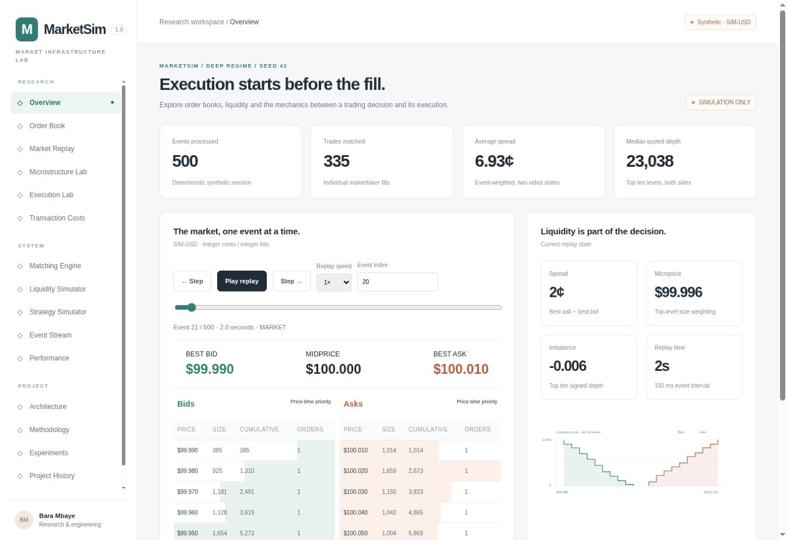
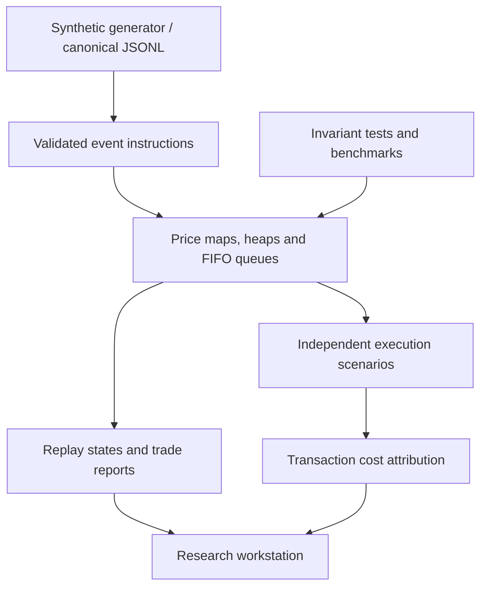

# MarketSim

**Market microstructure and execution laboratory.**

MarketSim reconstructs and simulates the path between a trading decision and its execution: price-time matching, liquidity consumption, queue behavior, execution schedules and transaction costs.



**Python · FIFO matching · event replay · execution research · custom browser interface**

Live demo: not deployed. Run locally or deploy the included container. This is a new project, independent of MarketLab, with the same visual family.

## Fifteen-second tour

Open Overview, then Market Replay and press Play. Inspect a cancellation's before/after state. In Execution Lab, compare BUY 5,000 across market, passive, TWAP, VWAP and POV. In Matching Engine, enter a limit order and submit an opposing market order. Finish at Transaction Costs and Architecture.

## Run

Python 3.11 or newer; no packages, credentials or accounts required:

```bash
python -m marketsim.server
```

Open http://localhost:8000. Unlike a static dashboard, the interface calls the actual Python engine. Double-clicking the HTML file is not supported.

```bash
python -m unittest discover -s tests -v
python -m marketsim.benchmark
docker build -t marketsim .
docker run --rm -p 8000:8000 marketsim
```

The Node `package.json` is only a managed-preview launcher; Node is not required for local use or Docker deployment.

## Core capabilities

- Integer-tick, integer-lot matching with best-price/FIFO priority, partial fills, cancellations and IOC market remainders.
- Replayable seeded event streams with before/after book states and inspectable fills.
- Independent mutable books for five execution methods, conserving parent quantity and consuming available liquidity.
- Prior-profile VWAP scheduling and one-event-lagged participation. No evaluated-session future volume leaks into schedules.
- Signed implementation shortfall, explicit fees, spread-plus-walk cost, delay and unfilled opportunity cost.
- Common-seed scenario comparisons, browser-persisted experiment records and portable JSON exports.
- Measured 10,000 / 100,000 / 1,000,000-command engine benchmarks.
- Six synthetic liquidity regimes and 16 coordinated workspace sections.

## Data and provenance

The redistributable sample in `data/events.jsonl` is **synthetic**, generated by this repository with seed 42. It is not historical exchange data. `data.py` loads canonical order-level JSONL with strict sequencing and validates it by replaying the matching engine. No commercial feed or unlicensed historical dataset is bundled.

The UI uses the seeded generator; canonical files can be loaded with the Python API. A historical upload UI and venue-specific adapters are not included. Aggregate Level 2 updates do not provide enough identity information to recover exact FIFO queues. See [DATA.md](docs/DATA.md).

## Architecture



The application is divided into engine, simulation, execution, analytics, data, server and benchmark modules. Frontend components and research renderers are separate from interaction orchestration. The API is stateless: manual commands are replayed to rebuild a sandbox; no global live order book is shared between visitors.

## Data structures and complexity

Each side has a price-level map and a min-heap (negative prices for bids). Each price holds an ordered dictionary keyed by order ID. Resting-order lookup and same-price append/removal are expected O(1). A new price level costs O(log H), where H includes stale heap entries. Best quote is O(1) after lazy cleanup; removing stale prices costs O(log H) each. Matching K orders costs O(K + removed-level cleanup), excluding report serialization. Snapshots sort prices and sum displayed queues and are deliberately outside the matching hot path.

Order identities and trades are retained for auditability, so memory grows with total commands/fills. Lazy heaps also retain empty-level entries until that side is queried. Production archival/compaction would need a durable event store and explicit retention. There is no claim of a bounded-memory, exchange-ready service.

## Validation and performance

The delivered suite has 29 tests covering FIFO/price priority, crossing limits, partial and multilevel fills, invalid operations, IOC behavior, microprice, imbalance, generated-stream invariants, serialization, deterministic replay, schedules and TCA reconciliation.

The bundled benchmark processed 1,000,000 alternating insert/cancel commands in approximately **9.89 seconds**, approximately **101,113 commands/second**, on the recorded Linux/Python 3.12.14 host. This is one measured run, without executions, networking, snapshots or rendering. It is not a matching-latency percentile or a production service capacity claim. Exact measurements and environment are in `web/benchmarks.json`; rerun on your machine.

## Methodology and scope

The purpose is to understand execution mechanics, not predict prices or demonstrate profitability. Every experiment is labeled simulation-only. Microstructure relationships are descriptive. Passive orders receive exact FIFO treatment only because all synthetic displayed orders are known. Counterfactual execution changes its own book but does not change background agents' intentions.

The bundled six-regime study preserves 600 strategy evaluations, including missing-cost outcomes. See [EXPERIMENTS.md](docs/EXPERIMENTS.md) for the protocol and interpretation, and [SCHEMAS.md](docs/SCHEMAS.md) for data contracts.

See [METHODOLOGY.md](docs/METHODOLOGY.md) for costs, queue assumptions and horizon semantics, [DEPLOYMENT.md](docs/DEPLOYMENT.md) for hosting, and [CAREER.md](docs/CAREER.md) for project descriptions and interview preparation.

## Repository

`marketsim/`: matching, replay, execution, analytics, API, canonical loader and benchmarks.

`web/`: custom responsive frontend and measured benchmark artifact.

`tests/`: numerical, deterministic and invariant regressions.

`data/`: representative synthetic event stream and provenance.

`docs/`: methodology, schemas, deployment, audit and interview materials.

## Explicit limitations and next work

One synthetic instrument; fixed 100 ms event intervals; preset regimes. No historical feed connector, hidden liquidity, auctions, self-trade prevention, venue routing, behavioral impact, realistic latency, fitted alpha or exact historical queue estimation. The UI does not support arbitrary aggregation or instrument switching. The benchmark is a single workload, not comprehensive profiling. The standard-library server is a reference backend and requires a hardened reverse proxy and operational review before unrestricted public traffic.

Next evidence-driven extensions: licensed order-level historical adapter, timestamp-aware replay, queue uncertainty bounds, time-weighted statistics, matching-heavy latency distributions, durable experiment storage and bounded order-history retention.

## Author

Bara Mbaye · Mechanical Engineering, University of Georgia · Expected May 2028.

Interests: quantitative research, markets, financial systems, data engineering, market infrastructure and institutional investing. No social links have been invented.
